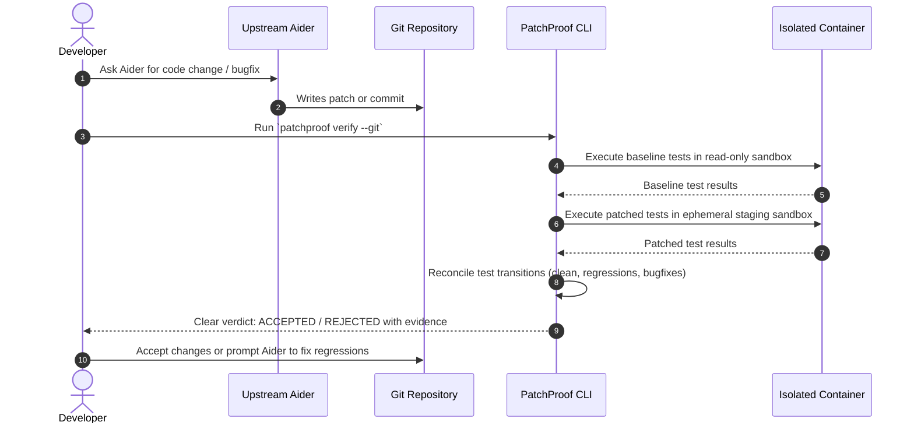

# PatchProof: The First-User Journey & Developer Experience

**Author:** Developer Experience Lead & Principal Product Engineer  
**Document:** `docs/FIRST_USER_JOURNEY.md`  
**Purpose:** End-to-end user experience specification for PatchProof developers  
**Date:** November 21, 2026

---

## 1. Vision: The Aider + PatchProof Workflow

PatchProof works alongside [Aider](https://github.com/paul-gauthier/aider) as an independent verification layer:



> [!NOTE]
> **Marketing & Safety Principle:** PatchProof must **never** be marketed as proving code correctness. PatchProof proves **empirical regression freedom and preservation of existing test suite contracts** within an isolated execution sandbox.

---

## 2. The 9-Step Golden User Journey

### Step 1: Install PatchProof
The developer installs PatchProof using standard Python packaging:

```bash
# Recommended for CLI tools (isolated from project venvs):
pipx install patchproof

# Or in an active virtual environment:
pip install patchproof
```

**Common Error:** `command not found: patchproof`  
**User Recovery Guidance:**
```text
Error: 'patchproof' executable is not on your PATH.
Remediation:
  If installed via pipx, run: pipx ensurepath
  If installed via pip, ensure your active Python virtual environment's bin/Scripts directory is in your PATH.
```

---

### Step 2: Check System Prerequisites (`patchproof doctor`)
Before running verification, the developer checks their environment with a single self-healing command:

```bash
patchproof doctor
```

**Expected User-Facing Output (All Healthy):**
```text
PatchProof Doctor — System Readiness Check
--------------------------------------------------
[✔] Python Version:        3.11.8 (Supported: >=3.11)
[✔] Git CLI:               git version 2.44.0 (Found)
[✔] Docker CLI:            Docker version 27.0.3 (Found)
[✔] Docker Daemon:         Active (Connection OK)
[✔] Docker Engine Mode:    Linux (WSL2 / Linux containers)
[✔] Runner Container:      patchproof-runner-python:3.11 (Present locally)
--------------------------------------------------
Status: Environment ready for isolated verification.
```

**Common Error: Docker Desktop Offline:**
```text
[✖] Docker Daemon:         Unavailable
--------------------------------------------------
Status: System not ready.
Remediation:
  1. Docker Desktop is not currently running.
  2. Launch Docker Desktop from your Start Menu / Applications.
  3. Ensure Docker is configured in Linux Containers mode (Settings -> General).
  4. Rerun 'patchproof doctor' once Docker has started.
```

**Common Error: Missing Runner Image:**
```text
[✖] Runner Container:      patchproof-runner-python:3.11 (Not found)
--------------------------------------------------
Remediation:
  Run 'patchproof setup-runner' to automatically build the standard isolated runner image locally:
    $ patchproof setup-runner
```

---

### Step 3: Select a Repository
PatchProof automatically discovers the current Git repository root if executed within any subdirectory of a project:

```bash
cd my_project/src/controllers
patchproof verify --git
# Automatically resolves repo root to /path/to/my_project
```

**Common Error: Not in a Git repository and `--repo` not specified:**
```text
patchproof: error: target directory '.' is not a Git repository.
Remediation:
  Run patchproof from inside your project directory, or provide the repository path explicitly:
    $ patchproof verify patch.diff --repo /path/to/project
```

---

### Step 4: Supply a Patch or Git Change
Developers can supply code changes in the three most common formats:

1. **Working Tree Changes (Aider uncommitted edit):**
   ```bash
   patchproof verify --git
   ```
2. **Latest Commit (Aider auto-commit):**
   ```bash
   patchproof verify --head
   ```
3. **Patch File or Unified Diff:**
   ```bash
   patchproof verify aider_fix.patch
   ```
4. **Standard Input (Pipe from any tool):**
   ```bash
   git diff origin/main...HEAD | patchproof verify -
   ```

**Common Error: Empty Diff / No Changes Detected:**
```text
patchproof: error: no changes detected in working tree.
Remediation:
  Your repository has no uncommitted changes.
  If your change was already committed, use:
    $ patchproof verify --head
```

---

### Step 5 & 6: Dual-Run Test Execution (Baseline & Patched)
During execution, the CLI displays clean terminal progress indicators so the developer knows exactly what is happening:

```text
[1/3] Running baseline tests against current code (:ro)... ⏳ [pytest: 42 passed in 1.8s]
[2/3] Staging isolated copy & applying patch...          ✔ [Clean: 1 file modified]
[3/3] Running patched tests in isolated sandbox (:ro)... ⏳ [pytest: 43 passed in 1.9s]
```

**Common Error: Container Timeout Exceeded:**
```text
[✖] Patched test execution timed out after 15.0 seconds.
Remediation:
  The test suite took longer than the configured timeout (15.0s).
  Increase the timeout with the --timeout flag:
    $ patchproof verify --git --timeout 60
  Or configure a default timeout in .patchproof.toml:
    [sandbox]
    timeout_seconds = 60.0
```

---

### Step 7 & 8: Inspect Comparison & Understand Verdict
The terminal renders a clear, high-contrast, high-signal dashboard:

```text
==============================================================================
                      PATCHPROOF VERIFICATION REPORT
==============================================================================
Target Repo:  /home/dev/projects/payment-service
Image:        patchproof-runner-python:3.11
Change Type:  Git Working Tree Diff (2 files changed, +14/-3 lines)
------------------------------------------------------------------------------
VERDICT:      ACCEPTED (Clean Preservation & Defect Resolution)
Summary:      Patch verified clean: 42 test(s) preserved, 1 defect(s) resolved, 0 regressions.
------------------------------------------------------------------------------
Metrics:
  - Preserved Passing Tests:  42
  - Resolved Defects:          1   (tests/test_billing.py::test_stripe_webhook_retry)
  - Introduced Regressions:    0
  - Suppressed Tests:          0
  - Pre-existing Failures:     0
  - Collection Failure:       No
------------------------------------------------------------------------------
Execution Times:
  - Baseline Execution:       1.82s (Exit code 1)
  - Patched Execution:        1.91s (Exit code 0)
==============================================================================
Recommended Action:
  ✔ Safe to commit or merge: code resolved the target bug without breaking existing tests.
```

**When a Regression is Introduced:**
```text
==============================================================================
                      PATCHPROOF VERIFICATION REPORT
==============================================================================
VERDICT:      REJECTED (Introduced Regressions Detected)
Summary:      Patch rejected: introduced 1 regression(s) in existing test suite.
------------------------------------------------------------------------------
Introduced Regressions (BROKEN BY PATCH):
  [REGRESSION]  tests/test_auth.py::test_jwt_expiration (PASS -> FAIL)
------------------------------------------------------------------------------
Diagnostic Traceback (Stderr Preview):
  >       assert token.is_expired() is True
  E       AssertionError: assert False is True
  tests/test_auth.py:48: AssertionError
==============================================================================
Recommended Action:
  ✖ Reject this patch: prompt Aider to fix 'test_jwt_expiration' before accepting.
```

---

### Step 9: Export and Share Evidence
Developers can export verification artifacts for code review, pull requests, or CI records:

```bash
# Export structured JSON report for automation or CI gates:
patchproof verify --git --json > verification_report.json

# Export a self-contained, responsive HTML report for team sharing:
patchproof verify --git --html report.html
```

---

## 3. Configuration System (`.patchproof.toml`)

Developers can commit a `.patchproof.toml` file to their repository root to avoid repeating CLI flags:

```toml
# .patchproof.toml
[sandbox]
image = "patchproof-runner-python:3.11"
timeout_seconds = 30.0
tmpfs_size_mb = 512

[test]
# Custom test command inside container
command = "pytest tests/unit -q"

[reporting]
verbose = false
html_export = false
```

---

## 4. Upstream Aider Workflow Integration

Developers frequently pair Aider and PatchProof using shell aliases or custom Aider configurations:

```bash
# Add to ~/.bashrc or ~/.zshrc:
alias aider-verify="patchproof verify --git"
```

In an active Aider session:
1. `aider` generates code changes.
2. Developer runs `/run patchproof verify --git` inside Aider's interactive prompt.
3. PatchProof runs in its isolated container and prints the verdict.
4. If regressions exist, Aider automatically sees the traceback and fixes its own mistakes!
