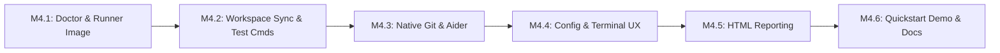

# PatchProof: Productization Roadmap & Milestone M4 Plan

**Author:** Principal Product Engineer & Security Architect  
**Document:** `docs/PRODUCT_ROADMAP.md`  
**Target:** Milestone M4 (Real User Productization)  
**Status:** **PROPOSED — AWAITING USER REVIEW & AUTHORIZATION**

---

## 1. Productization Objectives & Guiding Principles

The objective of Milestone M4 is to bridge the gap between PatchProof's verified core engine and a polished, developer-ready product that works seamlessly alongside Aider.

### Guiding Engineering Principles
1. **Preserve M1–M3 Architecture:** The core parsing, AST analysis, isolation models, and comparative reconciliation remain intact.
2. **Zero Host Execution Fallback:** Sandboxing security remains inviolate.
3. **Fail-Closed by Default:** Every new feature must preserve deterministic exit codes.
4. **No Marketing Claims of "Correctness":** Maintain accurate framing as empirical test preservation.
5. **Small, Verifiable Increments:** Each phase is independently testable with 100% test coverage and strict type annotations.

---

## 2. Milestone M4 Sub-Milestones



---

### Milestone M4.1 — Runner Image Packaging & System Doctor (`patchproof doctor`)

#### 1. User Problem
New users cannot execute `patchproof verify` out-of-the-box because the default image `patchproof-runner-python:3.11` does not exist on Docker Hub, and there is no command to diagnose Docker readiness.

#### 2. Why Necessary
Without a known runner image and preflight diagnosis, 100% of new users will fail during their first verification run.

#### 3. Affected Files
- `src/patchproof/cli.py` (Add `doctor` and `setup-runner` subcommands)
- `src/patchproof/sandbox/preflight.py` (Expose detailed diagnostic checks)
- `docker/runner.Dockerfile` (New standard runner Dockerfile with Python 3.11, pytest, unprivileged user)
- `tests/unit/test_doctor.py` (New test suite)

#### 4. Acceptance Criteria
- `patchproof doctor` checks Python version, Git CLI, Docker CLI, Docker daemon connectivity, Linux container mode, and runner image existence.
- Each check outputs a clear `[✔]` or `[✖]` with actionable recovery instructions.
- `patchproof setup-runner` builds `patchproof-runner-python:3.11` locally if missing.
- Returns exit code 0 if all checks pass; exit code 1 if any check fails.

#### 5. Regression Tests
- Test all doctor checks in healthy environment.
- Test missing Docker CLI, stopped daemon, Windows container mode, and missing image.

#### 6. Security Implications
- Runner image uses unprivileged UID `10001:10001`, disables root, and contains no secrets.

---

### Milestone M4.2 — Container Workspace Synchronization & Custom Test Commands

#### 1. User Problem
The container mounts the host repo at `/repo` (`:ro`), but runs `pytest` in `/workspace` (empty tmpfs). By default, zero tests are discovered. Additionally, developers cannot run a subset of tests (e.g. `pytest tests/unit/test_billing.py`).

#### 2. Why Necessary
Developers must be able to run tests against their actual code and target specific test files to avoid long test suite runtimes.

#### 3. Affected Files
- `src/patchproof/models/sandbox.py` (Add `test_command` field to `ContainerConfig`)
- `src/patchproof/sandbox/docker_cli.py` (Sync `/repo` into `/workspace` via container entrypoint wrapper or run `pytest` in `/repo` with `-o cache_dir=/tmp`)
- `src/patchproof/cli.py` (Add `--test-command` / `-c` CLI option)
- `tests/unit/sandbox/test_docker_cli.py`, `tests/unit/test_cli.py`

#### 4. Acceptance Criteria
- Running `patchproof verify` against a sample repository executes tests against actual repository files.
- `--test-command "pytest tests/test_calc.py -q"` runs only the specified test subset.
- Test execution leaves zero files on the host repository (`:ro` invariant preserved).

#### 5. Regression Tests
- Verify `/repo` remains read-only.
- Verify custom test commands are executed in container without shell injection vulnerabilities.

#### 6. Security Implications
- Custom test commands must be validated to prevent host command injection. Commands run strictly inside the container with `--network none`.

---

### Milestone M4.3 — Native Git & Aider Workflow Integration

#### 1. User Problem
Developers working with Aider must manually pipe `git diff` into `patchproof verify -` or write diff files to disk.

#### 2. Why Necessary
Developers want zero-friction verification: generate code in Aider -> run `patchproof verify --git` -> review evidence.

#### 3. Affected Files
- `src/patchproof/cli.py` (Add `--git` and `--head` flags)
- `src/patchproof/core/git_provider.py` (New module: extracts working tree diff or latest commit diff safely via `git diff HEAD` using `shell=False`)
- `tests/unit/test_git_provider.py`

#### 4. Acceptance Criteria
- `patchproof verify --git`: Automatically captures uncommitted changes in current repository.
- `patchproof verify --head`: Automatically captures changes introduced by `HEAD` commit.
- Gracefully errors if not inside a Git repo or if working tree is clean.

#### 5. Regression Tests
- Test `--git` with dirty working tree, clean working tree, and untracked files.
- Test `--head` with standard commits and initial commit.

#### 6. Security Implications
- Git commands must execute with `shell=False` and bounded capture to prevent argument injection or hanging.

---

### Milestone M4.4 — Configuration System & Developer Ergonomics

#### 1. User Problem
Developers must retype `--image`, `--timeout`, and `--test-command` on every invocation. Long container runs lack progress feedback.

#### 2. Why Necessary
Project-level configuration ensures consistent team verification. Progress spinners prevent developers from thinking the CLI has frozen.

#### 3. Affected Files
- `src/patchproof/config.py` (New: loads `.patchproof.toml` or `pyproject.toml [tool.patchproof]`)
- `src/patchproof/cli.py` (Add visual progress phases and colorized output)
- `tests/unit/test_config.py`

#### 4. Acceptance Criteria
- Automatically discovers `.patchproof.toml` in repository root.
- CLI flags override configuration file settings.
- Terminal renders clean step-by-step progress: `[1/3] Running baseline...`, `[2/3] Staging...`, `[3/3] Running patched...`.

#### 5. Regression Tests
- Test configuration precedence: CLI flags > `.patchproof.toml` > defaults.
- Test malformed TOML files produce helpful syntax errors.

#### 6. Security Implications
- Config parser must strictly validate types and resource bounds (timeout capped at 300s, tmpfs size capped at 1024MB).

---

### Milestone M4.5 — Standalone Visual HTML Report Generation

#### 1. User Problem
Terminal output scrolls away and raw JSON is hard to share with teammates during PR reviews.

#### 2. Why Necessary
A self-contained HTML report allows developers to attach verifiable evidence to pull requests, Slack, or issue trackers.

#### 3. Affected Files
- `src/patchproof/reporting/html_report.py` (New: generates single-file HTML report with KaTeX / pure CSS)
- `src/patchproof/cli.py` (Add `--html <path>` option)
- `tests/unit/test_html_report.py`

#### 4. Acceptance Criteria
- `patchproof verify patch.diff --html report.html` writes a single, standalone HTML file.
- Contains verdict badge, summary metrics, execution durations, and interactive test transition table.
- Contains zero external JavaScript/CSS dependencies (works fully offline).

#### 5. Regression Tests
- Verify HTML is well-formed and sanitizes test names and tracebacks against XSS.

#### 6. Security Implications
- All test names, error messages, and diff contents must be HTML-escaped to prevent stored XSS when opened in a browser.

---

### Milestone M4.6 — Interactive Demo, Sample Repository & User Documentation

#### 1. User Problem
New developers have no quick way to test PatchProof without risking their own project repositories. `README.md` is outdated.

#### 2. Why Necessary
First impressions matter. An interactive demo command and clear documentation enable a new user to succeed in under 2 minutes.

#### 3. Affected Files
- `src/patchproof/cli.py` (Add `demo` subcommand)
- `examples/demo_calculator/` (Sample repository fixture with unit tests)
- `examples/patches/` (`01_clean_optimization.patch`, `02_introduced_bug.patch`, `03_bugfix.patch`)
- `README.md` (Complete rewrite: quickstart, architecture, Aider workflow, troubleshooting)

#### 4. Acceptance Criteria
- `patchproof demo` creates a temporary playground repository and runs clean, regression, and bugfix scenarios with full explanations.
- `README.md` includes clear installation instructions, quickstart guide, and Aider workflow examples.

#### 5. Regression Tests
- Automated test verifies `patchproof demo` runs cleanly and exits 0.

#### 6. Security Implications
- Demo runs in standard system temp directory and is cleaned up on exit.

---

## 3. Release Sequence & Dependency Graph

```text
M4.1 (Doctor & Runner Image) 
   │
   ▼
M4.2 (Workspace Sync & Custom Test Commands)
   │
   ▼
M4.3 (Native Git & Aider Workflow Integration)
   │
   ▼
M4.4 (Configuration & Terminal Ergonomics)
   │
   ▼
M4.5 (Standalone HTML Reports)
   │
   ▼
M4.6 (Demo Playground & Documentation Rewrite)
```

Each sub-milestone will be executed strictly following TDD, Ruff, strict Mypy, independent reviewer signoff, and explicit user authorization.
